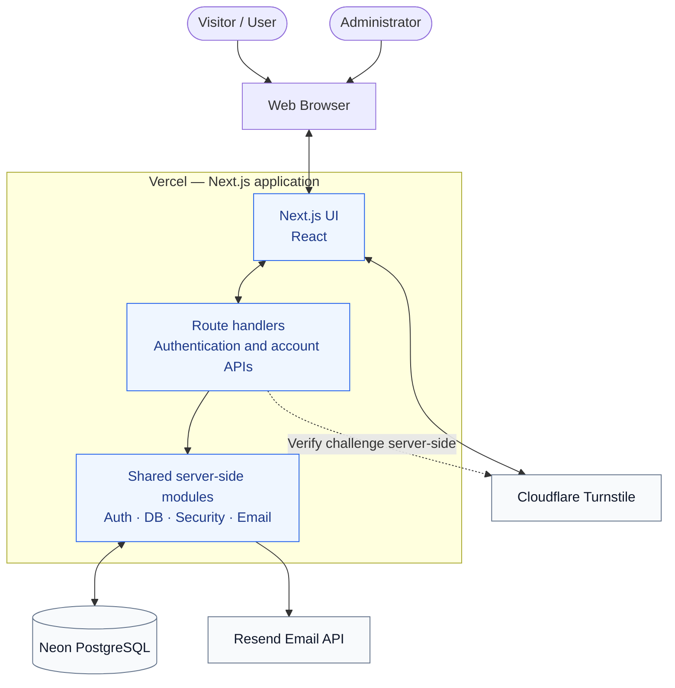
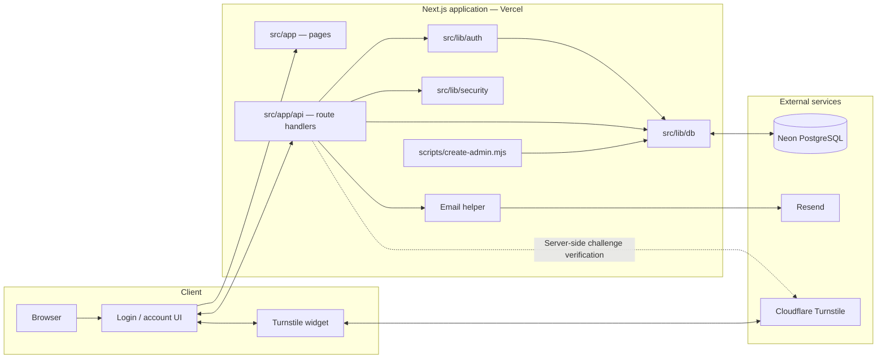
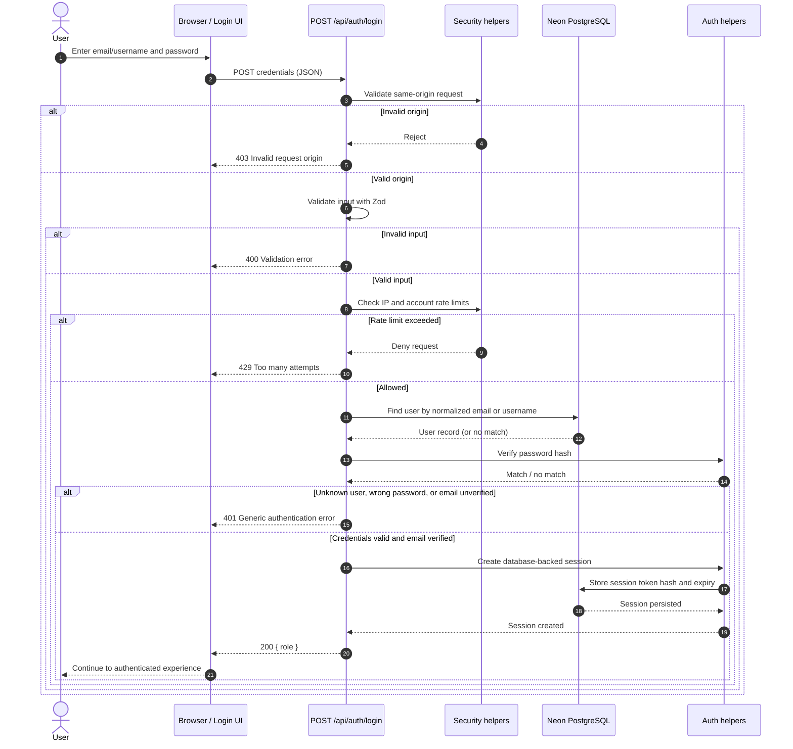
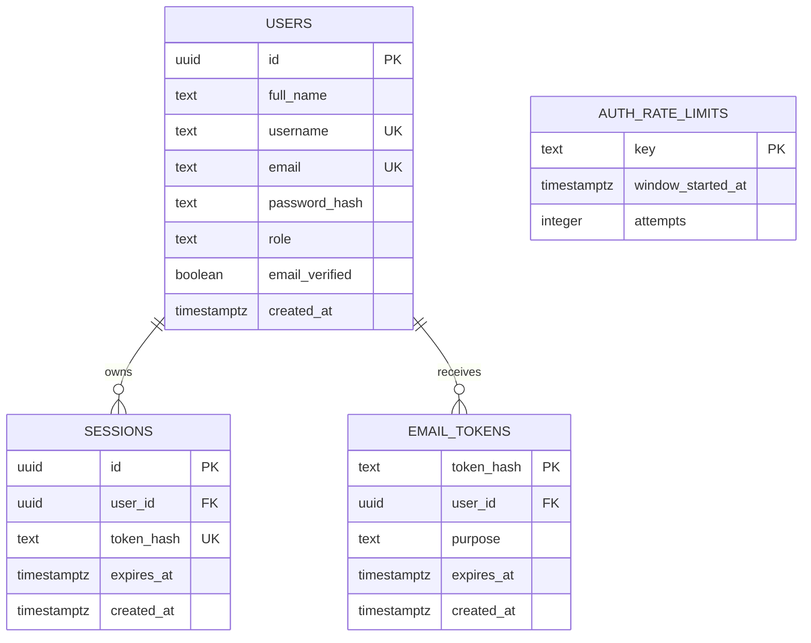
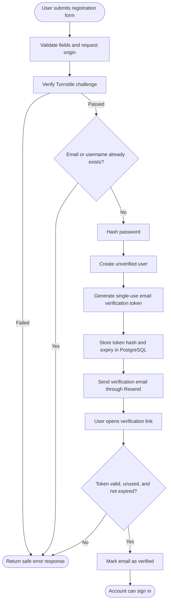
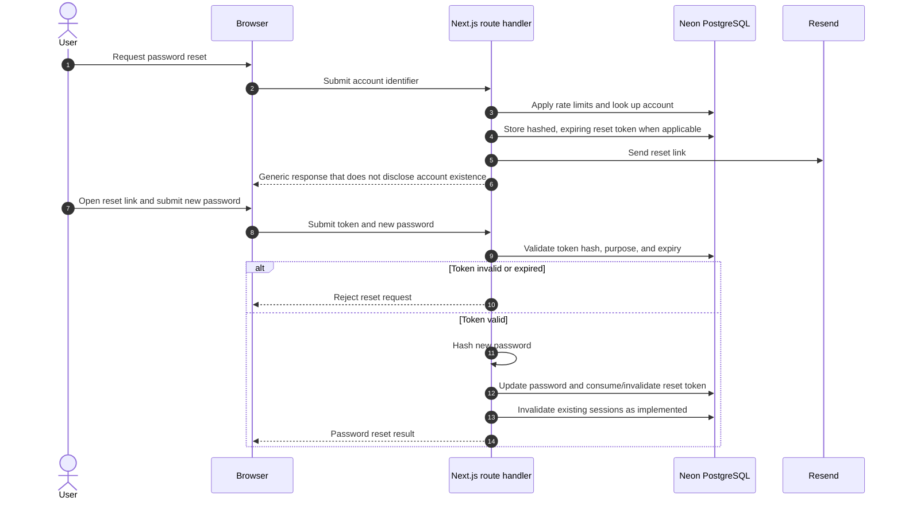
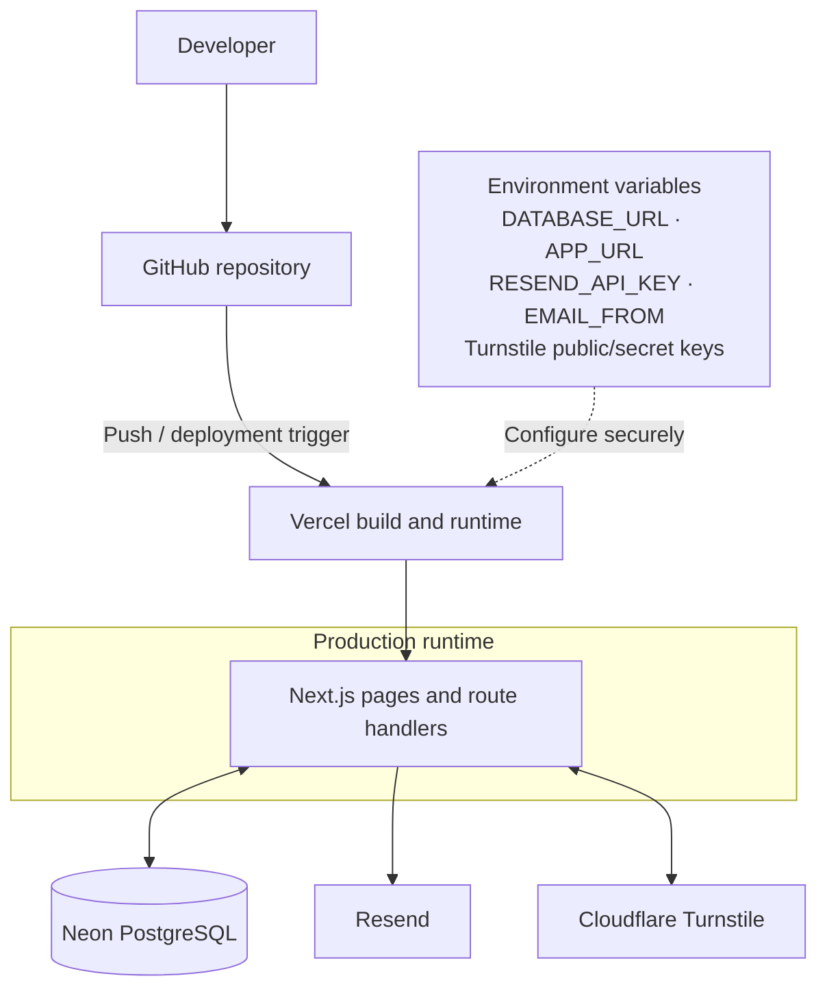

# UML — Muhmol Accounts

> UML documentation for the `1-login-page` application. Diagrams are maintained as Mermaid source so they render directly in GitHub and remain easy to review in pull requests.

## Scope and implementation notes

The diagrams below describe the repository's documented architecture and database schema: a Next.js application with server-side route handlers, shared authentication/security/database helpers, Neon PostgreSQL, Resend email delivery, and Cloudflare Turnstile. The login sequence is based on the current `src/app/api/auth/login/route.ts` implementation.

These are design/documentation diagrams, not generated source code. Update them when routes, schema, or authentication behavior changes.

## 1. System context

## 2. Component diagram

## 3. Authentication — login sequence

## 4. Data model — entity relationship diagram

**Model notes**

- `users` has case-insensitive unique indexes for `email` and `username`.
- `sessions.user_id` and `email_tokens.user_id` reference `users.id` with `ON DELETE CASCADE`.
- `email_tokens.purpose` is constrained to `verify_email` or `reset_password`; each user can have at most one token per purpose.
- `auth_rate_limits` stores rate-limit counters and is keyed by a hashed/derived key; it is not directly related to a user by a foreign key.
- Passwords are represented by `password_hash`. Session and email-action tokens are stored as hashes, not as raw tokens.

## 5. Registration and email verification — logical flow

> This is a logical workflow based on the documented registration and email-verification behavior. Keep it synchronized with the registration and verification route handlers if implementation details change.

## 6. Password reset — logical flow

> Review this sequence against the current reset route before changing implementation. It captures the intended security flow; exact token-consumption and session-invalidation behavior should follow the route code.

## 7. Deployment view

## Source of truth

- Application routes and UI: `src/app/`
- Shared server-side behavior: `src/lib/`
- Database schema: `database/schema.sql`
- Administrator provisioning: `scripts/create-admin.mjs`
- Setup and deployment instructions: `README.md`

Do not commit `.env.local`, API keys, database credentials, raw passwords or session/reset/verification tokens.
